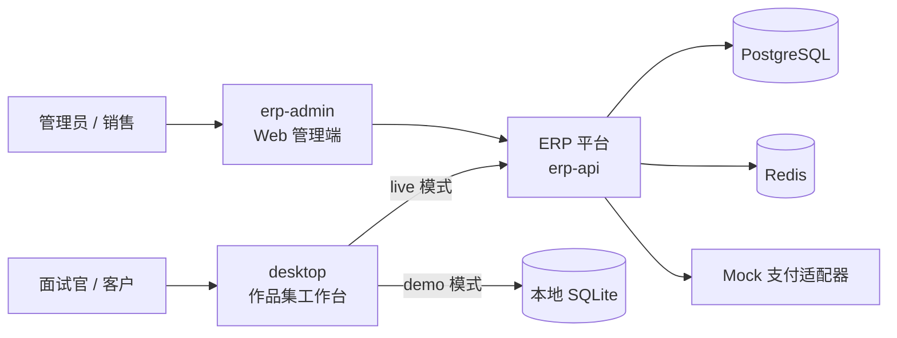
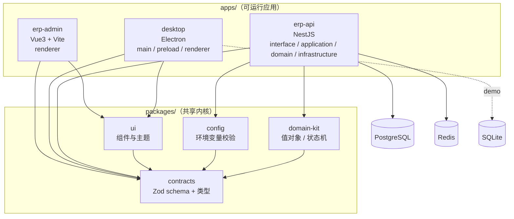

# C4 架构图

> 建模约定：Context 讲「谁用系统」，Container 讲「系统由哪些可部署单元组成」，Component 在 P1 后按领域上下文补齐。

## L1 · System Context

**外部依赖为零**：所有外部服务在生产由适配器替换，演示时全部走本地实现。

## L2 · Container

## 依赖方向 🔴

`apps → packages` 单向。`packages` 之间只允许 `ui / config / domain-kit → contracts`；**禁止** `contracts` 依赖任何其他包；**禁止** apps 之间互相 import。完整矩阵见 [`../design/README.md`](../design/README.md)。

## 变化点

| 变化 | 需更新的图 |
|---|---|
| 新增一个端（移动 / 第三方） | L1 + L2 |
| 新增限界上下文 | L2 Component（P1 补） |
| 替换数据库或支付通道 | L2 基础设施连线 |
